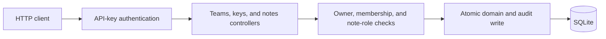
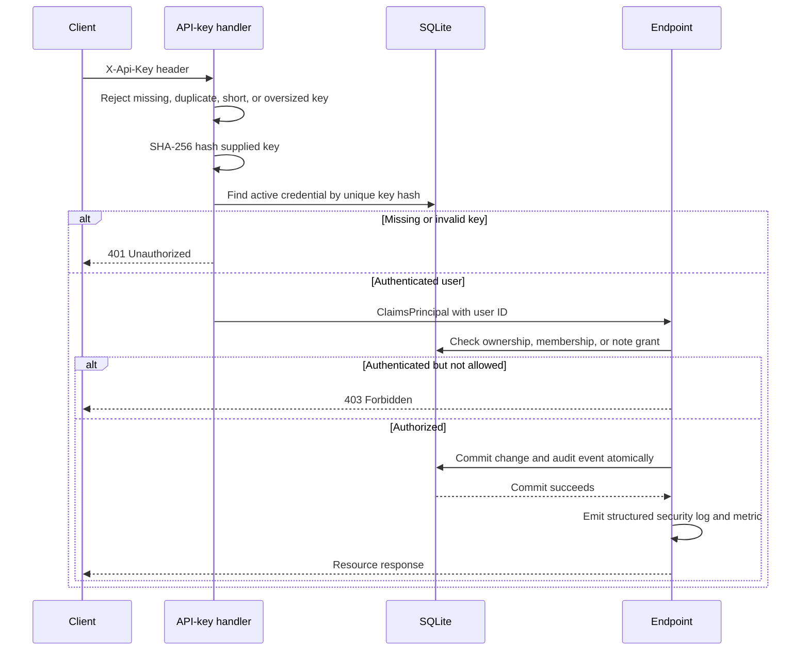

# Bluestaq Notes API

A small-team note service built with ASP.NET Core, Entity Framework Core, and SQLite. It supports owner-managed invitations, ownership transfer, revocable API keys, restricted notes with reader/editor grants, optimistic concurrency, HMAC-protected security auditing, API versioning, and filtered full-text discovery.

The implementation is deliberately a modular monolith: one deployable API, one local database, explicit DTOs, and no external infrastructure.

## Prerequisites

- [.NET SDK 10.0.402](https://dotnet.microsoft.com/download/dotnet/10.0) or a later 10.0 patch (`global.json` permits patch roll-forward)
- `curl` for the examples below
- `sqlite3` only for the optional backup, restore, and integrity-check runbook

## Quick start

From the repository root:

```bash
dotnet restore
dotnet build --no-restore
dotnet run --project src/Bluestaq.Notes.Api --launch-profile http
```

The API listens on `http://localhost:5212`. On first start it applies the checked-in EF Core migrations, creates `notes.db`, and seeds two development-only users. The database and build outputs are ignored by Git.

Development credentials are intentionally public and only loaded in the `Development` environment:

| User | User ID | API key |
|---|---|---|
| Alice | `11111111-1111-1111-1111-111111111111` | `dev-alice-api-key` |
| Bob | `22222222-2222-2222-2222-222222222222` | `dev-bob-api-key-01` |

Send the key in the `X-Api-Key` header. The database stores only SHA-256 hashes, not the cleartext keys.

Interactive API documentation is available in Development at [http://localhost:5212/swagger](http://localhost:5212/swagger). Select **Authorize**, enter one of the development API keys, and Swagger UI will send the `X-Api-Key` header to protected endpoints. The OpenAPI document includes the source XML summaries and is not exposed outside the Development environment.

### Production bootstrap and recovery

Production has no fixture users and requires a secret-delivered, 256-bit audit integrity key. Administrative authority stays out of the HTTP surface:

```bash
export ASPNETCORE_ENVIRONMENT=Production
export Hardening__AuditIntegrityKey="$(openssl rand -base64 32)"

dotnet run --project src/Bluestaq.Notes.Api -- \
  bootstrap --display-name Administrator --key-name Initial
```

The command succeeds only when the user table is empty and prints the new API key once. Store it immediately. Recovery atomically revokes the user's active keys and prints one replacement:

```bash
dotnet run --project src/Bluestaq.Notes.Api -- \
  recover-credential --user-id USER_ID --key-name Recovered
```

Verify all post-migration audit HMACs or preview/perform explicit retention:

```bash
dotnet run --project src/Bluestaq.Notes.Api -- verify-audit
dotnet run --project src/Bluestaq.Notes.Api -- prune-audit --before 2026-01-01T00:00:00Z
dotnet run --project src/Bluestaq.Notes.Api -- prune-audit --before 2026-01-01T00:00:00Z --confirm
```

Bootstrap, recovery, and confirmed pruning append administrative audit events. Rows created before HMAC support are reported as `LegacyUnverifiable` instead of being misrepresented as verified.

## Running tests

```bash
dotnet test Bluestaq.Notes.slnx
```

Run the full-route smoke workflow by itself:

```bash
dotnet test Bluestaq.Notes.slnx --filter "Category=Smoke"
```

The smoke test calls every endpoint through the real ASP.NET Core pipeline, including invitations, credential lifecycle, team administration, note permissions, security audit history, search/listing, and note CRUD. It also proves that missing or invalid credentials receive `401` and that membership removal takes effect immediately.

The remaining unit and integration tests cover validation and content limits, owner boundaries, concurrent key changes, expiry-preserving rotation, throttled activity writes, restricted-note roles, stale note writes, health checks, security telemetry, membership revocation, audit authorization/redaction/immutability, FTS5 search, cursor traversal, persistence, bidirectional migrations, and Development-only Swagger. Tests use isolated temporary SQLite databases and require no external services.

### Code coverage

Collect coverage with the configured Coverlet data collector:

```bash
dotnet test Bluestaq.Notes.slnx --configuration Release --collect:"XPlat Code Coverage"
```

The verified 2026-11-10 Release run passed all 41 tests and measured **96.21% line coverage** (3,635/3,778 lines) and **76.08% branch coverage** (315/414 branches) across the API assembly. Line coverage includes generated EF migration/designer code and property accessors, so branch coverage is the more conservative signal. CI enforces minimums of 90% line coverage and 70% branch coverage.

Scan direct and transitive NuGet dependencies against the configured advisory sources:

```bash
dotnet list package --vulnerable --include-transitive
```

The verified 2026-11-10 scan found no vulnerable packages in either the API or test project using the `https://api.nuget.org/v3/index.json` advisory source.

GitHub Actions runs these checks for every pull request and push to `main`. The workflows verify formatting, restore local tools, treat Release build warnings as errors, reject pending EF model changes, scan direct/transitive packages for CVEs and committed secrets, run CodeQL, run all tests, enforce 90% line and 70% branch coverage, and smoke-test the production container. Actions are pinned to immutable commit SHAs; Dependabot tracks NuGet, Docker, and workflow updates. CVE JSON, TRX, and Cobertura reports are uploaded as artifacts.

## API

Except for health, every endpoint requires `X-Api-Key`.

Every `/api/...` endpoint is also available under `/api/v1/...`. Legacy responses include `Deprecation`, `Sunset`, and successor `Link` headers so clients can migrate without a flag day.

| Method | Path | Purpose | Success |
|---|---|---|---|
| `GET` | `/health` | Liveness check | `200` |
| `GET` | `/health/live` | Process liveness check | `200` |
| `GET` | `/health/ready` | Database-backed readiness check | `200`/`503` |
| `POST` | `/api/teams` | Create a team; creator becomes owner/member | `201` |
| `GET` | `/api/teams` | List the caller's teams | `200` |
| `GET` | `/api/teams/{teamId}` | Get a team and its members | `200` |
| `PATCH` | `/api/teams/{teamId}` | Rename a team (owner only) | `200` |
| `DELETE` | `/api/teams/{teamId}` | Delete a team (owner only) | `204` |
| `POST` | `/api/teams/{teamId}/invitations` | Create a user/member and one-time key (owner only) | `201` |
| `POST` | `/api/teams/{teamId}/members` | Add a member (owner only) | `201` |
| `DELETE` | `/api/teams/{teamId}/members/{userId}` | Remove a non-owner member (owner only) | `204` |
| `PUT` | `/api/teams/{teamId}/owner` | Transfer ownership to a current member | `200` |
| `GET` | `/api/api-keys` | List the caller's key metadata | `200` |
| `POST` | `/api/api-keys` | Create a named key; secret returned once | `201` |
| `POST` | `/api/api-keys/{keyId}/rotate` | Replace one of the caller's keys | `201` |
| `DELETE` | `/api/api-keys/{keyId}` | Revoke one of the caller's non-final keys | `204` |
| `POST` | `/api/teams/{teamId}/notes` | Create a `team` or `restricted` note | `201` |
| `GET` | `/api/teams/{teamId}/notes` | Search/filter authorized notes with cursor pagination | `200` |
| `GET` | `/api/notes/{noteId}` | Retrieve a note | `200` |
| `PUT` | `/api/notes/{noteId}` | Replace content using the current `If-Match` ETag | `200` |
| `DELETE` | `/api/notes/{noteId}` | Delete a note (creator or owner) | `204` |
| `GET` | `/api/notes/{noteId}/permissions` | List grants (creator or owner) | `200` |
| `PUT` | `/api/notes/{noteId}/permissions/{userId}` | Set `reader`/`editor` grant | `200` |
| `DELETE` | `/api/notes/{noteId}/permissions/{userId}` | Remove a grant | `204` |
| `GET` | `/api/security-events` | List changes performed by or affecting the caller | `200` |
| `GET` | `/api/teams/{teamId}/security-events` | List team security changes (owner only) | `200` |

Note listing accepts `q`, `createdById`, `updatedAfter`, `cursor`, and `pageSize` (1–100). Audit listing accepts `cursor` and `pageSize`. Both return newest-first results and an opaque `nextCursor`. Team reads and note reads return a strong ETag such as `"1"`. Team administrative writes plus note update/delete/permission writes require the current value in `If-Match`, returning `428` when absent and `412` when stale. Errors use RFC 7807 Problem Details.

### Example workflow

Create a team:

```bash
curl -i http://localhost:5212/api/teams \
  -H 'X-Api-Key: dev-alice-api-key' \
  -H 'Content-Type: application/json' \
  -d '{"name":"Platform"}'
```

The response includes the new team ID:

```json
{
  "id": "5a8a1dda-ae14-4c08-8918-263e91cf11fd",
  "name": "Platform",
  "ownerId": "11111111-1111-1111-1111-111111111111",
  "createdAt": "2026-11-10T18:00:00Z",
  "version": 1,
  "members": [
    {
      "userId": "11111111-1111-1111-1111-111111111111",
      "displayName": "Alice",
      "joinedAt": "2026-11-10T18:00:00Z"
    }
  ]
}
```

Copy that `id` into `TEAM_ID`, then invite a user or add existing development user Bob and create a note:

```bash
TEAM_ID='5a8a1dda-ae14-4c08-8918-263e91cf11fd'

curl -i "http://localhost:5212/api/teams/$TEAM_ID/members" \
  -H 'X-Api-Key: dev-alice-api-key' \
  -H 'If-Match: "1"' \
  -H 'Content-Type: application/json' \
  -d '{"userId":"22222222-2222-2222-2222-222222222222"}'

curl -i "http://localhost:5212/api/teams/$TEAM_ID/notes" \
  -H 'X-Api-Key: dev-alice-api-key' \
  -H 'Content-Type: application/json' \
  -d '{"title":"Deployment decision","content":"Use the modular monolith."}'
```

Copy the returned note `id` into `NOTE_ID` to retrieve, update, and delete it:

```bash
NOTE_ID='b76e35a0-b6e8-47e7-b1ba-02bad1c9275a'

curl -i "http://localhost:5212/api/notes/$NOTE_ID" \
  -H 'X-Api-Key: dev-bob-api-key-01'

curl -i -X PUT "http://localhost:5212/api/notes/$NOTE_ID/permissions/22222222-2222-2222-2222-222222222222" \
  -H 'X-Api-Key: dev-alice-api-key' \
  -H 'If-Match: "1"' \
  -H 'Content-Type: application/json' \
  -d '{"role":"editor"}'

curl -i -X PUT "http://localhost:5212/api/notes/$NOTE_ID" \
  -H 'X-Api-Key: dev-bob-api-key-01' \
  -H 'If-Match: "2"' \
  -H 'Content-Type: application/json' \
  -d '{"title":"Deployment decision","content":"Use one API and SQLite for this assessment."}'

curl -i -X DELETE "http://localhost:5212/api/notes/$NOTE_ID" \
  -H 'X-Api-Key: dev-alice-api-key' \
  -H 'If-Match: "3"'
```

List notes:

```bash
curl -i "http://localhost:5212/api/teams/$TEAM_ID/notes?q=deployment&pageSize=25" \
  -H 'X-Api-Key: dev-alice-api-key'
```

## Architecture and data model



- `User` owns many independently revocable `ApiKeyCredential` rows and team memberships.
- `Team` has exactly one transferable owner. Creation inserts the owner's membership, and an integer version protects administrative writes.
- `TeamMembership` has a composite `(TeamId, UserId)` primary key, preventing duplicates.
- `Note` belongs to one team, has immutable `team`/`restricted` visibility, and carries an integer concurrency version exposed as an ETag.
- `NotePermission` grants `reader` or `editor` to a current member. Restricted notes require an explicit grant unless the caller is creator/owner; membership removal clears grants.
- `SecurityAuditEvent` stores immutable actor/action/target snapshots without foreign keys plus an HMAC-SHA256 integrity tag, so evidence survives target deletion and offline verification detects modification.
- `ReadinessProbe` is a durable sentinel updated inside a rolled-back transaction to prove database writeability without changing business data.
- Foreign keys protect references; team deletion would cascade to memberships/notes, while user references are restricted.
- Indexes support API-key lookup, membership lookup, team-note ordering, and FTS5 title/content search.

Controllers own HTTP semantics and the small amount of orchestration. EF Core owns parameterized persistence and migrations. Request/response DTOs keep database entities out of the wire contract. This avoids service/repository layers that would only forward calls in the current scope.

### Project structure

| Path | Responsibility |
|---|---|
| `Auth/` | API-key validation, hashing, generation, and identity-claim access |
| `Contracts/` | Request and response types that define the HTTP wire contract |
| `Controllers/` | Endpoint validation, authorization, orchestration, and response mapping |
| `Data/` | EF Core entities, relational configuration, initialization, and migrations |
| `Administration/` | Out-of-band bootstrap, credential recovery, audit verification, and retention commands |
| `Observability/` | Correlation identifiers, legacy API lifecycle headers, and trace integration |
| `Security/` | Preconditions plus transactional, HMAC-tagged security audit events |
| `tests/` | HTTP integration tests and the full-route smoke workflow |

Hand-written production types and methods include XML `summary` comments so their intent appears in source and IDE tooltips. EF Core migration and designer files are generated artifacts and retain the framework-generated documentation.

## Design decisions and tradeoffs

### 1. Opaque API keys rather than a login/JWT subsystem

I considered ASP.NET Core Identity with passwords and JWTs, externally issued OIDC tokens, and opaque API keys. Identity would add registration, password storage, token issuance, and recovery flows unrelated to the note-domain assessment; OIDC would require external infrastructure. A custom ASP.NET authentication scheme with opaque keys provides real authenticated identity and integrates with `[Authorize]` while staying runnable offline.

Keys are 256-bit random values, length-bounded before hashing, and only SHA-256 hashes are queried from storage. Users can name, expire, rotate, and revoke their own keys; plaintext is returned only at creation. The checked-in keys are public development fixtures, not production secrets. Per-key scopes and administrative recovery remain out of scope.

### 2. Membership authorization at every resource boundary

I considered embedding team IDs into credentials or using a broad role such as `team-user`. Those approaches become stale when membership changes or are too coarse. Each note operation instead derives the user ID from the authenticated principal and checks current membership in the database. Membership changes are restricted to the team owner, and the owner cannot be removed.

This adds a small query cost per request but keeps revocation immediate and the rule easy to audit. Team-visible notes remain readable by all members; restricted notes require creator, owner, reader, or editor access. Creators and owners administer notes; editors may update but never delete. For a higher-volume service I would centralize the checks in resource-based authorization handlers and add carefully invalidated caching.

### 3. SQLite with migrations and UTC `DateTime`

I considered an in-memory store, PostgreSQL, and SQLite. An in-memory store would not prove persistence; PostgreSQL would make reviewers provision infrastructure. SQLite gives real constraints, transactions, and durable storage with a zero-service quick start. Checked-in EF migrations make schema creation deterministic.

Timestamps are stored as UTC `DateTime` rather than `DateTimeOffset` because SQLite/EF cannot server-order `DateTimeOffset` values. Opaque cursors contain the update time and ID tie-breaker, avoiding offset drift. FTS5 triggers keep the full-text index synchronized. SQLite is still a single-node choice with limited write concurrency; PostgreSQL would be the natural next step if usage outgrows small teams.

### 4. Transactional, append-only, HMAC-tagged security events

I considered console/file logs and an audit table linked by foreign keys. Operational logs are not atomic with database changes, and foreign keys would either block deletion or erase the evidence. Security mutations instead append a sanitized snapshot in the same EF transaction. Audit rows deliberately have no target foreign keys, while EF guards and SQLite triggers reject updates and deletes.

The tradeoff is storage growth, key management, and a small extra write per security change. Each new row has an HMAC-SHA256 tag over its immutable fields; `verify-audit` detects database-file tampering when the key remains outside the database. Events retain IDs and limited metadata, never plaintext API keys, hashes, or note content. Owner-only team history and caller-scoped personal history use cursor pagination. Retention is an explicit preview/confirm command that restores append-only triggers and records what it removed.

## Security

### Request security flow



Authentication answers **who is calling**; authorization answers **what that user may access**:

- `401 Unauthorized`: no API key, malformed key, unknown hash, or a revoked/expired credential.
- `403 Forbidden`: the key is valid, but the user lacks current membership, ownership, or note permission.
- `404 Not Found`: the caller is authenticated and the requested resource does not exist.

- Authentication is handled by ASP.NET Core; callers cannot select identity using a user-ID header or request field.
- API keys are accepted only through `X-Api-Key`, length-bounded, hashed, expiry/revocation checked, and matched against a unique indexed hash.
- Every team/note/key endpoint requires authentication. Note access requires live membership; sensitive mutations require ownership or an explicit role.
- Credential endpoints are scoped to the authenticated user, serialize lifecycle mutations with optimistic concurrency, preserve expiry during rotation, prevent revoking the final usable key, and never list plaintext secrets.
- Note updates require `If-Match`; stale writes cannot silently replace newer content. Restricted-note lookup avoids disclosing notes to ungranted members.
- Team administrative writes, note deletion, and permission mutations also require `If-Match`; ownership can be transferred only to a current member and every transfer is audited.
- Authenticated requests are rate-limited per user ID and anonymous requests per remote IP. Raw API keys are never rate-limit partition keys or telemetry values. Declared request bodies over 16 KiB are rejected before model binding.
- Credential `LastUsedAt` writes are limited to once per 15-minute interval per key to reduce SQLite write contention.
- Invitations, credential changes, membership changes, note grants, and team creation/deletion append sanitized audit events in the same transaction. Successful commits also emit event `2001` structured warnings and the `bluestaq.security.events.committed` metric; failed authentication emits event `1001` or `1002` without key material.
- Audit events survive target deletion. EF guards and SQLite triggers reject update/delete, HMAC verification detects direct-file mutation, team history is owner-only, and personal history is caller-scoped.
- `[ApiController]` and Data Annotations validate JSON shape and sizes. Additional checks reject empty GUIDs and whitespace-only names/titles.
- EF Core uses parameterized queries. Database constraints enforce foreign keys and unique memberships.
- Exception handling emits generic Problem Details rather than stack traces or database details.
- Configuration uses normal `appsettings`, environment-specific files, and environment-variable overrides such as `ConnectionStrings__Notes`.

Production still requires TLS, managed delivery/rotation of `Hardening__AuditIntegrityKey`, and a configured OpenTelemetry collector/alerting backend; OIDC/JWT may replace local keys when an identity provider exists. SHA-256 is suitable here because generated API keys are high-entropy tokens; it is not appropriate for human passwords.

## Retry and idempotency

- `GET` is safe to retry. `DELETE` is idempotent when the target was already removed or revoked only where the endpoint explicitly returns `204`; otherwise re-read current state first.
- Team administrative writes and note mutations are guarded by `If-Match`. On `412`, retrieve current state, reconcile, and retry with its new ETag. On `428`, supply the ETag from a prior read.
- Credential mutations may return `409` when another credential change wins. Re-list keys before retrying so the final-usable-key rule is evaluated against current state.
- `POST` creates are intentionally non-idempotent. Do not automatically retry after an unknown outcome: a second request can create another team, note, invitation, or key. Durable replay for credential creation would require storing recoverable secret responses, which this service deliberately avoids.

## Operations runbook

Use `/health/live` for process supervision and `/health/ready` for traffic admission. Readiness checks connectivity, verifies that no migrations are pending, updates the readiness sentinel, and rolls that write back. It returns `503` when any step fails. `/health` remains a liveness alias for compatibility. Responses include `X-Correlation-ID`; a valid caller value is preserved, otherwise the service creates one and attaches it to logs and traces.

Enable console trace export for local operational verification with `Hardening__EnableConsoleTracing=true`. Production should replace the console exporter with the organization's collector/exporter and alert policy.

### Container

Build and run the non-root production image with a persistent SQLite volume and externally supplied audit key:

```bash
docker build -t bluestaq-notes .
docker volume create bluestaq-notes-data
docker run --rm -p 8080:8080 \
  -e ASPNETCORE_ENVIRONMENT=Production \
  -e Hardening__AuditIntegrityKey="$AUDIT_INTEGRITY_KEY" \
  -v bluestaq-notes-data:/app/data \
  bluestaq-notes
curl --fail http://localhost:8080/health/ready
```

Before backing up a live database, use SQLite's online backup command so the main file and WAL are captured consistently:

```bash
sqlite3 notes.db ".backup 'notes-backup.db'"
sqlite3 notes-backup.db "PRAGMA integrity_check;"
```

`integrity_check` must return `ok`. To restore, stop request traffic, preserve the current database for rollback, copy the verified backup to the configured path, remove stale `-shm`/`-wal` sidecars only while the service is stopped, then start the service and confirm `/health/ready` plus a read-only API request.

Database migrations run at startup for this single-instance assessment. Before release, back up the database and inspect the generated SQL:

```bash
dotnet tool restore
dotnet tool run dotnet-ef migrations script --idempotent \
  --project src/Bluestaq.Notes.Api \
  --startup-project src/Bluestaq.Notes.Api
```

For rollback, stop traffic and restore the pre-migration backup; that is the safest path when a migration may discard data. A tested reversible migration can instead be targeted with `dotnet-ef database update <previous-migration>`, followed by `PRAGMA integrity_check` and readiness verification. Do not run two application instances against the same SQLite database during migration.

## Future improvements

With more time I would, in this order:

1. Add OIDC federation, fine-grained credential scopes, and organization-specific recovery approval.
2. Add immutable note-change history or soft deletion if product requirements justify it.
3. Move to PostgreSQL when measured write contention or dataset size warrants it. In a multi-instance deployment, run migrations as a controlled release step instead of application startup.

## Known limitations

- Invitations return a one-time key directly to the owner; email delivery and acceptance links are not implemented. Credential recovery is an operator command, not end-user self-service.
- API keys have no fine-grained scopes.
- OpenTelemetry console export is available, but no collector, dashboard, or alert rules are bundled. Audit HMACs detect modification only while the integrity key remains outside an attacker's control; they cannot prevent an administrator who controls both the database and key from rewriting history.
- FTS5 uses SQLite tokenization and literal phrase matching; it does not provide stemming, typo tolerance, or advanced ranking controls.
- SQLite targets a single local application instance, not horizontal production scale.
- Development HTTP is intentionally convenient for local evaluation. API keys must only travel over HTTPS outside that environment.

## Configuration and migrations

Override the database path with standard .NET configuration:

```bash
ConnectionStrings__Notes='Data Source=/absolute/path/notes.db' \
  dotnet run --project src/Bluestaq.Notes.Api --launch-profile http
```

Hardening settings use the same configuration system:

| Setting | Default | Purpose |
|---|---:|---|
| `Hardening__RequestBodyLimitBytes` | `16384` | Maximum declared request body |
| `Hardening__AuthenticatedPermitLimit` | `300` | Requests per authenticated user/window |
| `Hardening__AnonymousPermitLimit` | `60` | Requests per remote IP/window |
| `Hardening__RateLimitWindowSeconds` | `60` | Fixed-window duration |
| `Hardening__AuditIntegrityKey` | none | Required base64 key of at least 32 bytes |
| `Hardening__EnableConsoleTracing` | `false` | Enable local console span export |

The Development file contains a public local-only integrity key so the zero-setup fixtures remain runnable. Production startup fails validation when the key is missing or too short.

To create a future migration:

```bash
dotnet tool restore
dotnet tool run dotnet-ef migrations add MigrationName \
  --project src/Bluestaq.Notes.Api \
  --startup-project src/Bluestaq.Notes.Api \
  --output-dir Data/Migrations
```
