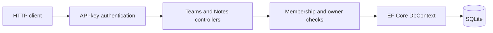

# Bluestaq Notes API

A small-team note service built with ASP.NET Core, Entity Framework Core, and SQLite. Authenticated users can create teams, manage team membership, and create, read, update, delete, or page through notes for teams they belong to.

The implementation is deliberately a modular monolith: one deployable API, one local database, explicit DTOs, and no external infrastructure.

## Prerequisites

- [.NET SDK 10.0.402](https://dotnet.microsoft.com/download/dotnet/10.0) or a later 10.0 patch (`global.json` permits patch roll-forward)
- `curl` for the examples below

## Quick start

From the repository root:

```bash
dotnet restore
dotnet build --no-restore
dotnet run --project src/Bluestaq.Notes.Api --launch-profile http
```

The API listens on `http://localhost:5212`. On first start it applies the checked-in EF Core migration, creates `notes.db`, and seeds two development-only users. The database and build outputs are ignored by Git.

Development credentials are intentionally public and only loaded in the `Development` environment:

| User | User ID | API key |
|---|---|---|
| Alice | `11111111-1111-1111-1111-111111111111` | `dev-alice-api-key` |
| Bob | `22222222-2222-2222-2222-222222222222` | `dev-bob-api-key-01` |

Send the key in the `X-Api-Key` header. The database stores only SHA-256 hashes, not the cleartext keys.

## Running tests

```bash
dotnet test Bluestaq.Notes.slnx
```

The 10 integration-test cases exercise the HTTP pipeline, authentication, note CRUD and listing, validation and content limits, missing resources, cross-team authorization, owner-only membership changes, pagination limits, and persistence through a fresh EF Core context. Tests use an isolated temporary SQLite database and require no external services.

## API

Except for health, every endpoint requires `X-Api-Key`.

| Method | Path | Purpose | Success |
|---|---|---|---|
| `GET` | `/health` | Liveness check | `200` |
| `POST` | `/api/teams` | Create a team; creator becomes owner/member | `201` |
| `GET` | `/api/teams` | List the caller's teams | `200` |
| `GET` | `/api/teams/{teamId}` | Get a team and its members | `200` |
| `POST` | `/api/teams/{teamId}/members` | Add a member (owner only) | `201` |
| `DELETE` | `/api/teams/{teamId}/members/{userId}` | Remove a non-owner member (owner only) | `204` |
| `POST` | `/api/teams/{teamId}/notes` | Create a team note | `201` |
| `GET` | `/api/teams/{teamId}/notes?page=1&pageSize=25` | List team notes, newest first | `200` |
| `GET` | `/api/notes/{noteId}` | Retrieve a note | `200` |
| `PUT` | `/api/notes/{noteId}` | Replace a note's title/content | `200` |
| `DELETE` | `/api/notes/{noteId}` | Delete a note | `204` |

`pageSize` accepts 1–100. Team names are limited to 100 characters, note titles to 200, and note content to 10,000. Errors use RFC 7807 Problem Details with appropriate `400`, `401`, `403`, `404`, `409`, or `500` status codes.

### Example workflow

Create a team:

```bash
curl -i http://localhost:5212/api/teams \
  -H 'X-Api-Key: dev-alice-api-key' \
  -H 'Content-Type: application/json' \
  -d '{"name":"Platform"}'
```

The response includes the new team ID:

```json
{
  "id": "5a8a1dda-ae14-4c08-8918-263e91cf11fd",
  "name": "Platform",
  "ownerId": "11111111-1111-1111-1111-111111111111",
  "createdAt": "2026-11-10T18:00:00Z",
  "members": [
    {
      "userId": "11111111-1111-1111-1111-111111111111",
      "displayName": "Alice",
      "joinedAt": "2026-11-10T18:00:00Z"
    }
  ]
}
```

Copy that `id` into `TEAM_ID`, then add Bob and create a note:

```bash
TEAM_ID='5a8a1dda-ae14-4c08-8918-263e91cf11fd'

curl -i "http://localhost:5212/api/teams/$TEAM_ID/members" \
  -H 'X-Api-Key: dev-alice-api-key' \
  -H 'Content-Type: application/json' \
  -d '{"userId":"22222222-2222-2222-2222-222222222222"}'

curl -i "http://localhost:5212/api/teams/$TEAM_ID/notes" \
  -H 'X-Api-Key: dev-alice-api-key' \
  -H 'Content-Type: application/json' \
  -d '{"title":"Deployment decision","content":"Use the modular monolith."}'
```

Copy the returned note `id` into `NOTE_ID` to retrieve, update, and delete it:

```bash
NOTE_ID='b76e35a0-b6e8-47e7-b1ba-02bad1c9275a'

curl -i "http://localhost:5212/api/notes/$NOTE_ID" \
  -H 'X-Api-Key: dev-bob-api-key-01'

curl -i -X PUT "http://localhost:5212/api/notes/$NOTE_ID" \
  -H 'X-Api-Key: dev-bob-api-key-01' \
  -H 'Content-Type: application/json' \
  -d '{"title":"Deployment decision","content":"Use one API and SQLite for this assessment."}'

curl -i -X DELETE "http://localhost:5212/api/notes/$NOTE_ID" \
  -H 'X-Api-Key: dev-alice-api-key'
```

List notes:

```bash
curl -i "http://localhost:5212/api/teams/$TEAM_ID/notes?page=1&pageSize=25" \
  -H 'X-Api-Key: dev-alice-api-key'
```

## Architecture and data model



- `User` owns an API-key hash and can have many `TeamMembership` rows.
- `Team` has exactly one owner. Creation also inserts the owner's membership.
- `TeamMembership` has a composite `(TeamId, UserId)` primary key, preventing duplicates.
- `Note` belongs to one team and records its creator, last updater, and UTC timestamps.
- Foreign keys protect references; team deletion would cascade to memberships/notes, while user references are restricted.
- Indexes support API-key lookup, membership lookup, and team-note ordering.

Controllers own HTTP semantics and the small amount of orchestration. EF Core owns parameterized persistence and migrations. Request/response DTOs keep database entities out of the wire contract. This avoids service/repository layers that would only forward calls in the current scope.

## Design decisions and tradeoffs

### 1. Opaque API keys rather than a login/JWT subsystem

I considered ASP.NET Core Identity with passwords and JWTs, externally issued OIDC tokens, and opaque API keys. Identity would add registration, password storage, token issuance, and recovery flows unrelated to the note-domain assessment; OIDC would require external infrastructure. A custom ASP.NET authentication scheme with opaque keys provides real authenticated identity and integrates with `[Authorize]` while staying runnable offline.

Keys are length-bounded before hashing and only SHA-256 hashes are queried from storage. The tradeoff is that these keys have no expiry, scopes, rotation API, or revocation workflow. The checked-in keys are public development fixtures, not production secrets.

### 2. Membership authorization at every resource boundary

I considered embedding team IDs into credentials or using a broad role such as `team-user`. Those approaches become stale when membership changes or are too coarse. Each note operation instead derives the user ID from the authenticated principal and checks current membership in the database. Membership changes are restricted to the team owner, and the owner cannot be removed.

This adds a small query cost per request but keeps revocation immediate and the rule easy to audit. For a higher-volume service I would centralize the check in resource-based authorization handlers and add carefully invalidated caching.

### 3. SQLite with migrations and UTC `DateTime`

I considered an in-memory store, PostgreSQL, and SQLite. An in-memory store would not prove persistence; PostgreSQL would make reviewers provision infrastructure. SQLite gives real constraints, transactions, and durable storage with a zero-service quick start. Checked-in EF migrations make schema creation deterministic.

Timestamps are stored as UTC `DateTime` rather than `DateTimeOffset` because SQLite/EF cannot server-order `DateTimeOffset` values. This preserves indexed, deterministic pagination but assumes every writer follows the UTC convention. SQLite is also a single-node choice with limited write concurrency; PostgreSQL would be the natural next step if usage outgrows small teams.

## Security

- Authentication is handled by ASP.NET Core; callers cannot select identity using a user-ID header or request field.
- API keys are accepted only through `X-Api-Key`, length-bounded, hashed, and matched against a unique indexed hash.
- Every team/note endpoint requires authentication. Note access requires live team membership; membership mutation requires ownership.
- `[ApiController]` and Data Annotations validate JSON shape and sizes. Additional checks reject empty GUIDs and whitespace-only names/titles.
- EF Core uses parameterized queries. Database constraints enforce foreign keys and unique memberships.
- Exception handling emits generic Problem Details rather than stack traces or database details.
- Configuration uses normal `appsettings`, environment-specific files, and environment-variable overrides such as `ConnectionStrings__Notes`.

Production would require TLS, OIDC/JWT authentication, managed key/secret storage, rate limiting, audit logs, and a deliberate user-provisioning flow. SHA-256 is suitable here because API keys are high-entropy tokens; it is not appropriate for human passwords.

## Future improvements

With more time I would, in this order:

1. Replace development API keys and user seeding with OIDC/JWT validation, administrative provisioning, credential rotation/revocation, rate limiting, and security audit events.
2. Add optimistic concurrency (`ETag`/version) so simultaneous edits cannot silently overwrite one another, plus immutable note-change history or soft deletion if product requirements justify it.
3. Move to PostgreSQL and cursor pagination when measured write contention or dataset size warrants it. In a multi-instance deployment I would also stop applying migrations during every application startup and run them as a controlled release step.

## Known limitations

- Users are development fixtures; there are no user registration or API-key management endpoints.
- Any team member may update or delete any note in that team. There are no per-note roles.
- Teams cannot currently be renamed or deleted through the API.
- Pagination is offset-based and there is no full-text search or filtering.
- SQLite targets a single local application instance, not horizontal production scale.
- Development HTTP is intentionally convenient for local evaluation. API keys must only travel over HTTPS outside that environment.

## Configuration and migrations

Override the database path with standard .NET configuration:

```bash
ConnectionStrings__Notes='Data Source=/absolute/path/notes.db' \
  dotnet run --project src/Bluestaq.Notes.Api --launch-profile http
```

To create a future migration:

```bash
dotnet tool restore
dotnet tool run dotnet-ef migrations add MigrationName \
  --project src/Bluestaq.Notes.Api \
  --startup-project src/Bluestaq.Notes.Api \
  --output-dir Data/Migrations
```
