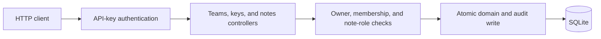
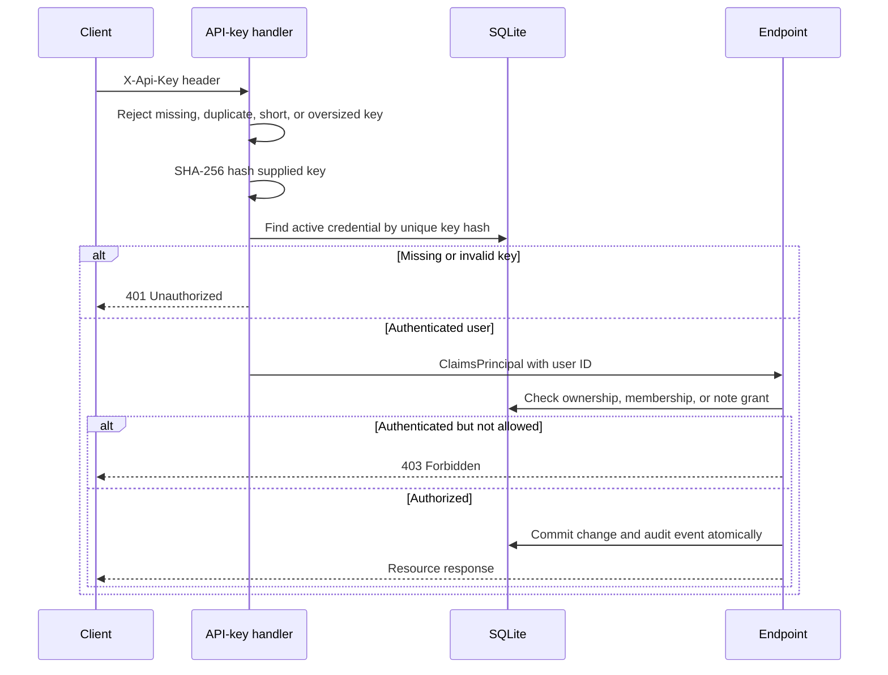

# Bluestaq Notes API

A small-team note service built with ASP.NET Core, Entity Framework Core, and SQLite. It supports owner-managed invitations, revocable API keys, team administration, per-note editor grants, and filtered full-text note discovery.

The implementation is deliberately a modular monolith: one deployable API, one local database, explicit DTOs, and no external infrastructure.

## Prerequisites

- [.NET SDK 10.0.402](https://dotnet.microsoft.com/download/dotnet/10.0) or a later 10.0 patch (`global.json` permits patch roll-forward)
- `curl` for the examples below

## Quick start

From the repository root:

```bash
dotnet restore
dotnet build --no-restore
dotnet run --project src/Bluestaq.Notes.Api --launch-profile http
```

The API listens on `http://localhost:5212`. On first start it applies the checked-in EF Core migrations, creates `notes.db`, and seeds two development-only users. The database and build outputs are ignored by Git.

Development credentials are intentionally public and only loaded in the `Development` environment:

| User | User ID | API key |
|---|---|---|
| Alice | `11111111-1111-1111-1111-111111111111` | `dev-alice-api-key` |
| Bob | `22222222-2222-2222-2222-222222222222` | `dev-bob-api-key-01` |

Send the key in the `X-Api-Key` header. The database stores only SHA-256 hashes, not the cleartext keys.

## Running tests

```bash
dotnet test Bluestaq.Notes.slnx
```

Run the full-route smoke workflow by itself:

```bash
dotnet test Bluestaq.Notes.slnx --filter "Category=Smoke"
```

The smoke test calls every endpoint through the real ASP.NET Core pipeline, including invitations, credential lifecycle, team administration, note permissions, security audit history, search/listing, and note CRUD. It also proves that missing or invalid credentials receive `401` and that membership removal takes effect immediately.

The remaining integration tests cover validation and content limits, owner boundaries, invitation/key lifecycle, expired and revoked keys, note roles, membership revocation, audit authorization/redaction/immutability, FTS5 search, cursor traversal, persistence, and bidirectional migrations. All 22 test cases use isolated temporary SQLite databases and require no external services.

### Code coverage

Collect coverage with the configured Coverlet data collector:

```bash
dotnet test Bluestaq.Notes.slnx --configuration Release --collect:"XPlat Code Coverage"
```

The verified 2026-11-10 Release run passed all 22 tests and measured **96.97% line coverage** (2,214/2,283 lines) and **77.45% branch coverage** (158/204 branches) across the API assembly. Line coverage includes generated EF migration/designer code and property accessors, so branch coverage is the more conservative signal. CI enforces minimums of 90% line coverage and 70% branch coverage.

Scan direct and transitive NuGet dependencies against the configured advisory sources:

```bash
dotnet list package --vulnerable --include-transitive
```

The verified 2026-11-10 scan found no vulnerable packages in either the API or test project using the `https://api.nuget.org/v3/index.json` advisory source.

GitHub Actions runs these checks for every pull request and push to `main`. The workflow fails on vulnerable direct/transitive NuGet packages, any test failure, line coverage below 90%, or branch coverage below 70%, and uploads the CVE JSON, TRX, and Cobertura reports as build artifacts.

## API

Except for health, every endpoint requires `X-Api-Key`.

| Method | Path | Purpose | Success |
|---|---|---|---|
| `GET` | `/health` | Liveness check | `200` |
| `POST` | `/api/teams` | Create a team; creator becomes owner/member | `201` |
| `GET` | `/api/teams` | List the caller's teams | `200` |
| `GET` | `/api/teams/{teamId}` | Get a team and its members | `200` |
| `PATCH` | `/api/teams/{teamId}` | Rename a team (owner only) | `200` |
| `DELETE` | `/api/teams/{teamId}` | Delete a team (owner only) | `204` |
| `POST` | `/api/teams/{teamId}/invitations` | Create a user/member and one-time key (owner only) | `201` |
| `POST` | `/api/teams/{teamId}/members` | Add a member (owner only) | `201` |
| `DELETE` | `/api/teams/{teamId}/members/{userId}` | Remove a non-owner member (owner only) | `204` |
| `GET` | `/api/api-keys` | List the caller's key metadata | `200` |
| `POST` | `/api/api-keys` | Create a named key; secret returned once | `201` |
| `POST` | `/api/api-keys/{keyId}/rotate` | Replace one of the caller's keys | `201` |
| `DELETE` | `/api/api-keys/{keyId}` | Revoke one of the caller's non-final keys | `204` |
| `POST` | `/api/teams/{teamId}/notes` | Create a team note | `201` |
| `GET` | `/api/teams/{teamId}/notes` | Search/filter notes with cursor pagination | `200` |
| `GET` | `/api/notes/{noteId}` | Retrieve a note | `200` |
| `PUT` | `/api/notes/{noteId}` | Replace content (creator, owner, or editor) | `200` |
| `DELETE` | `/api/notes/{noteId}` | Delete a note (creator or owner) | `204` |
| `GET` | `/api/notes/{noteId}/permissions` | List grants (creator or owner) | `200` |
| `PUT` | `/api/notes/{noteId}/permissions/{userId}` | Set `reader`/`editor` grant | `200` |
| `DELETE` | `/api/notes/{noteId}/permissions/{userId}` | Remove a grant | `204` |
| `GET` | `/api/security-events` | List changes performed by or affecting the caller | `200` |
| `GET` | `/api/teams/{teamId}/security-events` | List team security changes (owner only) | `200` |

Note listing accepts `q`, `createdById`, `updatedAfter`, `cursor`, and `pageSize` (1–100). Audit listing accepts `cursor` and `pageSize`. Both return newest-first results and an opaque `nextCursor`. Team names are limited to 100 characters, note titles to 200, and note content to 10,000. Errors use RFC 7807 Problem Details with appropriate `400`, `401`, `403`, `404`, `409`, or `500` status codes.

### Example workflow

Create a team:

```bash
curl -i http://localhost:5212/api/teams \
  -H 'X-Api-Key: dev-alice-api-key' \
  -H 'Content-Type: application/json' \
  -d '{"name":"Platform"}'
```

The response includes the new team ID:

```json
{
  "id": "5a8a1dda-ae14-4c08-8918-263e91cf11fd",
  "name": "Platform",
  "ownerId": "11111111-1111-1111-1111-111111111111",
  "createdAt": "2026-11-10T18:00:00Z",
  "members": [
    {
      "userId": "11111111-1111-1111-1111-111111111111",
      "displayName": "Alice",
      "joinedAt": "2026-11-10T18:00:00Z"
    }
  ]
}
```

Copy that `id` into `TEAM_ID`, then invite a user or add existing development user Bob and create a note:

```bash
TEAM_ID='5a8a1dda-ae14-4c08-8918-263e91cf11fd'

curl -i "http://localhost:5212/api/teams/$TEAM_ID/members" \
  -H 'X-Api-Key: dev-alice-api-key' \
  -H 'Content-Type: application/json' \
  -d '{"userId":"22222222-2222-2222-2222-222222222222"}'

curl -i "http://localhost:5212/api/teams/$TEAM_ID/notes" \
  -H 'X-Api-Key: dev-alice-api-key' \
  -H 'Content-Type: application/json' \
  -d '{"title":"Deployment decision","content":"Use the modular monolith."}'
```

Copy the returned note `id` into `NOTE_ID` to retrieve, update, and delete it:

```bash
NOTE_ID='b76e35a0-b6e8-47e7-b1ba-02bad1c9275a'

curl -i "http://localhost:5212/api/notes/$NOTE_ID" \
  -H 'X-Api-Key: dev-bob-api-key-01'

curl -i -X PUT "http://localhost:5212/api/notes/$NOTE_ID/permissions/22222222-2222-2222-2222-222222222222" \
  -H 'X-Api-Key: dev-alice-api-key' \
  -H 'Content-Type: application/json' \
  -d '{"role":"editor"}'

curl -i -X PUT "http://localhost:5212/api/notes/$NOTE_ID" \
  -H 'X-Api-Key: dev-bob-api-key-01' \
  -H 'Content-Type: application/json' \
  -d '{"title":"Deployment decision","content":"Use one API and SQLite for this assessment."}'

curl -i -X DELETE "http://localhost:5212/api/notes/$NOTE_ID" \
  -H 'X-Api-Key: dev-alice-api-key'
```

List notes:

```bash
curl -i "http://localhost:5212/api/teams/$TEAM_ID/notes?q=deployment&pageSize=25" \
  -H 'X-Api-Key: dev-alice-api-key'
```

## Architecture and data model



- `User` owns many independently revocable `ApiKeyCredential` rows and team memberships.
- `Team` has exactly one owner. Creation also inserts the owner's membership.
- `TeamMembership` has a composite `(TeamId, UserId)` primary key, preventing duplicates.
- `Note` belongs to one team and records its creator, last updater, and UTC timestamps.
- `NotePermission` grants `reader` or `editor` to a current member; membership removal clears grants.
- `SecurityAuditEvent` stores immutable actor/action/target snapshots without foreign keys, so evidence survives target deletion.
- Foreign keys protect references; team deletion would cascade to memberships/notes, while user references are restricted.
- Indexes support API-key lookup, membership lookup, team-note ordering, and FTS5 title/content search.

Controllers own HTTP semantics and the small amount of orchestration. EF Core owns parameterized persistence and migrations. Request/response DTOs keep database entities out of the wire contract. This avoids service/repository layers that would only forward calls in the current scope.

## Design decisions and tradeoffs

### 1. Opaque API keys rather than a login/JWT subsystem

I considered ASP.NET Core Identity with passwords and JWTs, externally issued OIDC tokens, and opaque API keys. Identity would add registration, password storage, token issuance, and recovery flows unrelated to the note-domain assessment; OIDC would require external infrastructure. A custom ASP.NET authentication scheme with opaque keys provides real authenticated identity and integrates with `[Authorize]` while staying runnable offline.

Keys are 256-bit random values, length-bounded before hashing, and only SHA-256 hashes are queried from storage. Users can name, expire, rotate, and revoke their own keys; plaintext is returned only at creation. The checked-in keys are public development fixtures, not production secrets. Per-key scopes and administrative recovery remain out of scope.

### 2. Membership authorization at every resource boundary

I considered embedding team IDs into credentials or using a broad role such as `team-user`. Those approaches become stale when membership changes or are too coarse. Each note operation instead derives the user ID from the authenticated principal and checks current membership in the database. Membership changes are restricted to the team owner, and the owner cannot be removed.

This adds a small query cost per request but keeps revocation immediate and the rule easy to audit. All members can read; creators and owners administer notes; editors may update but never delete. For a higher-volume service I would centralize the checks in resource-based authorization handlers and add carefully invalidated caching.

### 3. SQLite with migrations and UTC `DateTime`

I considered an in-memory store, PostgreSQL, and SQLite. An in-memory store would not prove persistence; PostgreSQL would make reviewers provision infrastructure. SQLite gives real constraints, transactions, and durable storage with a zero-service quick start. Checked-in EF migrations make schema creation deterministic.

Timestamps are stored as UTC `DateTime` rather than `DateTimeOffset` because SQLite/EF cannot server-order `DateTimeOffset` values. Opaque cursors contain the update time and ID tie-breaker, avoiding offset drift. FTS5 triggers keep the full-text index synchronized. SQLite is still a single-node choice with limited write concurrency; PostgreSQL would be the natural next step if usage outgrows small teams.

### 4. Transactional, append-only security events

I considered console/file logs and an audit table linked by foreign keys. Operational logs are not atomic with database changes, and foreign keys would either block deletion or erase the evidence. Security mutations instead append a sanitized snapshot in the same EF transaction. Audit rows deliberately have no target foreign keys, while EF guards and SQLite triggers reject updates and deletes.

The tradeoff is storage growth and a small extra write per security change. Events retain IDs and limited metadata, never plaintext API keys, hashes, or note content. Owner-only team history and caller-scoped personal history use cursor pagination.

## Security

### Request security flow



Authentication answers **who is calling**; authorization answers **what that user may access**:

- `401 Unauthorized`: no API key, malformed key, unknown hash, or a revoked/expired credential.
- `403 Forbidden`: the key is valid, but the user lacks current membership, ownership, or note permission.
- `404 Not Found`: the caller is authenticated and the requested resource does not exist.

- Authentication is handled by ASP.NET Core; callers cannot select identity using a user-ID header or request field.
- API keys are accepted only through `X-Api-Key`, length-bounded, hashed, expiry/revocation checked, and matched against a unique indexed hash.
- Every team/note/key endpoint requires authentication. Note access requires live membership; sensitive mutations require ownership or an explicit role.
- Credential endpoints are scoped to the authenticated user, prevent revoking the final usable key, and never list plaintext secrets.
- Invitations, credential changes, membership changes, note grants, and team creation/deletion append sanitized audit events in the same transaction.
- Audit events survive target deletion. EF guards and SQLite triggers reject update/delete; team history is owner-only and personal history is caller-scoped.
- `[ApiController]` and Data Annotations validate JSON shape and sizes. Additional checks reject empty GUIDs and whitespace-only names/titles.
- EF Core uses parameterized queries. Database constraints enforce foreign keys and unique memberships.
- Exception handling emits generic Problem Details rather than stack traces or database details.
- Configuration uses normal `appsettings`, environment-specific files, and environment-variable overrides such as `ConnectionStrings__Notes`.

Production would require TLS, managed secret delivery, rate limiting, and external audit export/monitoring; OIDC/JWT may replace local keys when an identity provider exists. SHA-256 is suitable here because generated keys are high-entropy tokens; it is not appropriate for human passwords.

## Future improvements

With more time I would, in this order:

1. Add rate limiting plus audit export, alerting, retention policy, and cryptographic integrity verification.
2. Add optimistic concurrency (`ETag`/version) so simultaneous edits cannot silently overwrite one another, plus immutable note-change history or soft deletion if product requirements justify it.
3. Move to PostgreSQL when measured write contention or dataset size warrants it. In a multi-instance deployment I would also stop applying migrations during every application startup and run them as a controlled release step.

## Known limitations

- Invitations return a one-time key directly to the owner; email delivery, acceptance links, account recovery, and ownership transfer are not implemented.
- `reader` grants document intent but do not narrow access yet because all current team members can read all team notes.
- API keys have no fine-grained scopes.
- Audit events have no configurable retention/export yet. SQLite triggers prevent normal mutation, but the log is not cryptographically tamper-evident against an administrator with direct database-file control.
- FTS5 uses SQLite tokenization and literal phrase matching; it does not provide stemming, typo tolerance, or advanced ranking controls.
- SQLite targets a single local application instance, not horizontal production scale.
- Development HTTP is intentionally convenient for local evaluation. API keys must only travel over HTTPS outside that environment.

## Configuration and migrations

Override the database path with standard .NET configuration:

```bash
ConnectionStrings__Notes='Data Source=/absolute/path/notes.db' \
  dotnet run --project src/Bluestaq.Notes.Api --launch-profile http
```

To create a future migration:

```bash
dotnet tool restore
dotnet tool run dotnet-ef migrations add MigrationName \
  --project src/Bluestaq.Notes.Api \
  --startup-project src/Bluestaq.Notes.Api \
  --output-dir Data/Migrations
```
